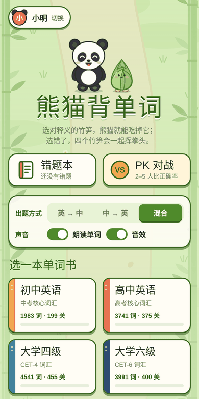
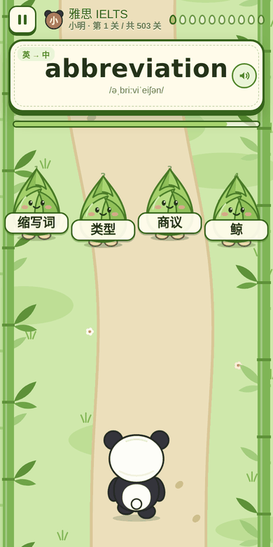
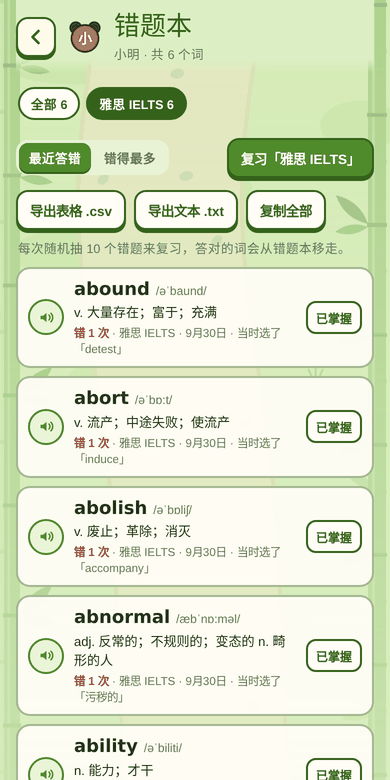

# 熊猫背单词

一个竖屏的背英语单词小游戏。熊猫沿着竹林小路一扭一扭往前走，前方冒出四个竹笋，每个竹笋上写着一个释义。点对了，熊猫跳过去把竹笋吃掉；点错了或者 5 秒内没选，四个竹笋会伸出拳头一起揍熊猫。

整个游戏是一个纯静态网页（一个 `index.html` 加 8 个词库 JSON），不需要服务器和数据库，可以直接用 GitHub Pages 发布。手机和电脑都能玩。

| 选玩家 | 首页 | 答题 | 答错挨揍 | 错题本 |
|:-:|:-:|:-:|:-:|:-:|
|  |  |  |  |  |

## 玩法

- 画面匀速向上滚动，熊猫一直往前走。
- 顶部提示栏出一个词：英文或中文，可以选「英 → 中」「中 → 英」或「混合」。
- 四个竹笋从上方冒出，慢慢靠近熊猫。每个词只有 5 秒。
- **选对**：熊猫跳过去，抱着竹笋咔嚓咔嚓吃掉。
- **选错**：四个竹笋围住熊猫挥拳，熊猫原地打滚一圈，并亮出正确答案。
- **超时**：同样挨揍，熊猫眼冒金星。
- 每关 10 个词。10 题全对 3 星，对 8 题 2 星，对 6 题 1 星。

## 功能

**8 本单词书**，关卡数按词量自动计算：

| 单词书 | 词数 | 关卡 |
|---|---:|---:|
| 初中英语 | 1983 | 199 |
| 高中英语 | 3741 | 375 |
| 大学四级 | 4541 | 455 |
| 大学六级 | 3991 | 400 |
| SAT | 4463 | 447 |
| PET（剑桥 B1） | 3045 | 305 |
| 托福 TOEFL | 10364 | 1037 |
| 雅思 IELTS | 5023 | 503 |

**玩家**：同一台设备最多 5 位玩家，每人有自己的名字、头像颜色、关卡星级和错题本。

**错题本**
- 答错和超时的词会自动记下，包括音标、释义、所属单词书、答错次数、最近一次答错的时间和当时选了哪个。
- 可以按单词书筛选，按「最近答错」或「错得最多」排序。
- 每个词都能听发音，会了就点「已掌握」移出。
- 选一本书可以复习，每次随机抽 10 个，答对的词会自动移出。
- 可以导出 `.csv`（Excel 能直接打开）或 `.txt`（按书分组，方便打印听写），也可以一键复制。

**PK 对战**
- 选单词书、起始关、关数（1/2/3/5 关）、出题方式，再选 2–5 位玩家。
- 所有人答完全相同的题目（同样的词、同样的选项和顺序）。
- 轮流挑战，按正确率排名；正确率相同时比用时，超时按 5 秒计。
- 中途放弃的话，没答的题都算错。
- 保留最近 30 局记录，可以接着「再比下一组」。

**其他**：浏览器自带的英文朗读、音效开关、暂停。电脑上可以用数字键 1–4 选竹笋，Esc 暂停，空格听发音。

## 部署到 GitHub Pages

1. 在 GitHub 新建一个仓库，例如 `panda-vocab`，把本目录下的所有文件上传进去（`tools/cache/` 不用传）。
2. 打开仓库的 **Settings → Pages**。
3. **Source** 选 **Deploy from a branch**，Branch 选 `main`、目录选 `/ (root)`，点 **Save**。
4. 等一两分钟，页面地址是 `https://你的用户名.github.io/panda-vocab/`。

## 在自己电脑上运行

词库是用 `fetch` 读取的，**直接双击 `index.html` 打不开词库**，需要起一个本地服务器。任选一种：

```bash
# Python 3
python3 -m http.server 8000

# 或者 Node.js
npx serve .
```

然后在浏览器打开 `http://localhost:8000`。

## 数据保存在哪里

玩家、星级、错题本和 PK 记录都保存在当前浏览器的 `localStorage` 里：

- 不上传到任何服务器。
- 换设备、换浏览器、清除网站数据后记录会消失。
- 手机和电脑之间不会同步。

重要的错题本请定期导出备份。

## 目录结构

```
├── index.html            # 整个游戏（HTML + CSS + JS 都在这一个文件里）
├── books/                # 8 本词库，每个词条是 [单词, 音标, 词性, 短释义, 完整释义]
├── tools/
│   ├── build_books.py    # 重新生成 books/ 的脚本
│   └── pet_words.txt     # PET 单词表
├── docs/                 # README 用的截图
├── LICENSE               # 代码许可（MIT）
└── THIRD_PARTY_NOTICES.md# 词库来源与许可
```

## 重新生成词库

```bash
python3 tools/build_books.py
```

脚本会自动下载原始词表到 `tools/cache/`（约 70 MB，已加入 `.gitignore`），再输出到 `books/`。如果生成后词数有变化，要同步修改 `index.html` 里 `BOOKS` 列表的 `count`。

## 加一本自己的单词书

1. 按同样的格式做一个 JSON 放进 `books/`，例如 `books/mybook.json`：
   ```json
   [["apple","ˈæpl","n","苹果","n. 苹果"],["banana","bəˈnɑ:nə","n","香蕉","n. 香蕉"]]
   ```
   第 4 项是显示在竹笋上的短释义，建议不超过 7 个字。
2. 在 `index.html` 里找到 `const BOOKS = [`，加一行：
   ```js
   { id: 'mybook', name: '我的单词书', desc: '自己整理的词', count: 2, color: '#6a994e' },
   ```

## 许可

- 代码：[MIT](LICENSE)
- 词库：来自 KyleBing/english-vocabulary（BSD 3-Clause）和 ECDICT（MIT），PET 单词表依据剑桥 B1 Preliminary 官方词表。详见 [THIRD_PARTY_NOTICES.md](THIRD_PARTY_NOTICES.md)。

## 致谢

- [KyleBing/english-vocabulary](https://github.com/KyleBing/english-vocabulary)
- [skywind3000/ECDICT](https://github.com/skywind3000/ECDICT)
- Cambridge English B1 Preliminary Vocabulary List
